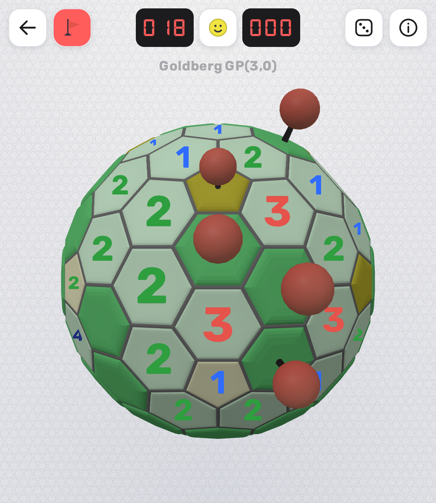
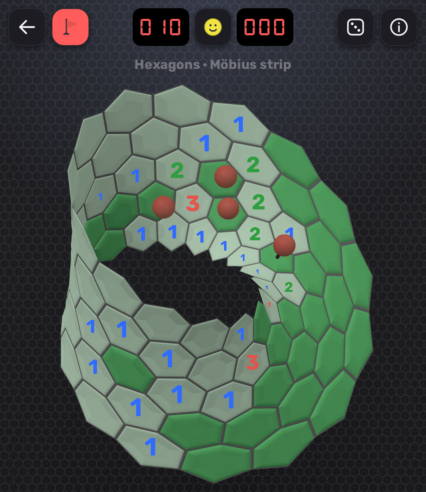
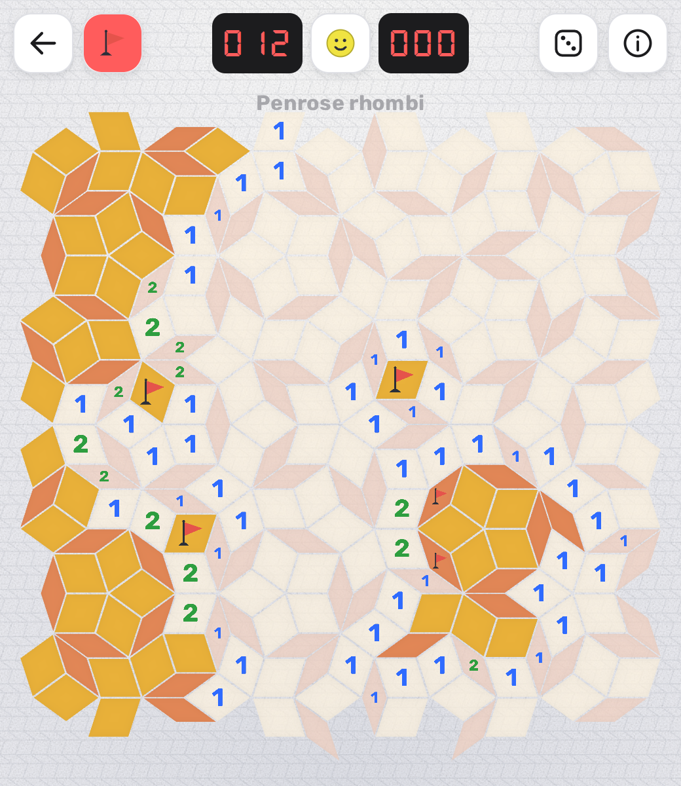
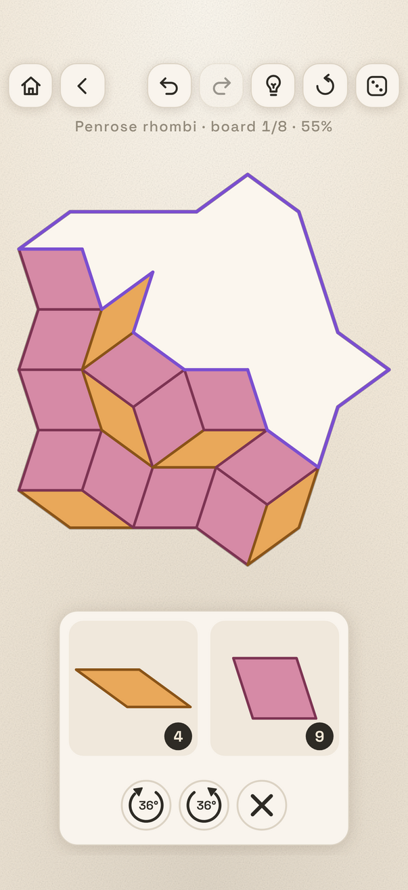
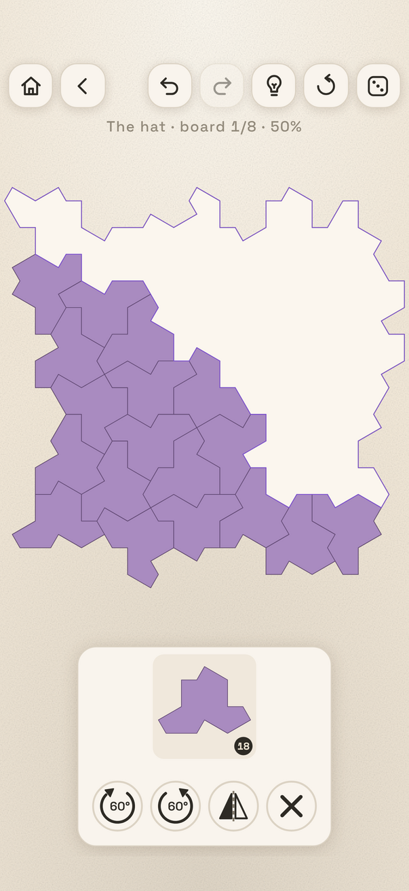
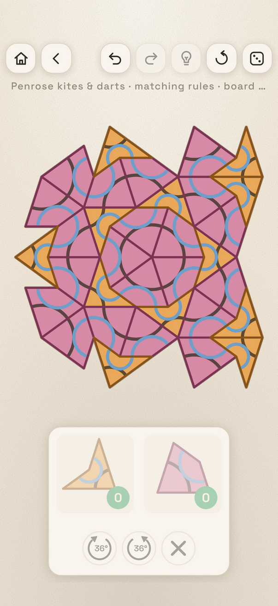

# Tiling games

Puzzle games played on tilings: flat, aperiodic, hyperbolic, and wrapped
around 3D surfaces. The games share one geometry package, so a tiling built
for one game is available to all of them.

**All games:** <https://tiling-games.pages.dev/>

## Hypersweeper

Minesweeper on almost any surface and tiling: Penrose mosaics, the hyperbolic
plane, Goldberg spheres, a Möbius strip, a Klein bottle, a trefoil knot.

**Play:** <https://hypersweeper.pages.dev/>. Read more in
[`apps/hypersweeper/README.md`](apps/hypersweeper/README.md).

<table>
  <tr>
    <td align="center"><br>A Goldberg sphere</td>
    <td align="center"><br>Hexagons on a Möbius strip</td>
    <td align="center"><br>Penrose rhombi</td>
  </tr>
</table>

## Rep-tiles

A drag-and-drop puzzle: cover the region exactly with the tiles in the tray.
Levels include regular and star polygons, Penrose tiles, the hat, the
spectre, and boards with matching rules, colourings and jigsaw edges.

**Play:** <https://tiling-games.pages.dev/rep-tiles/>. Read more in
[`apps/reptiles/README.md`](apps/reptiles/README.md).

<table>
  <tr>
    <td align="center"><br>Penrose rhombi</td>
    <td align="center"><br>The hat</td>
    <td align="center"><br>Kites and darts, finished</td>
  </tr>
</table>

## Repository layout

| Folder | What it is |
|---|---|
| [`apps/hypersweeper/`](apps/hypersweeper) | Hypersweeper (TypeScript and Three.js), plus its iPhone app |
| [`apps/reptiles/`](apps/reptiles) | Rep-tiles (TypeScript and SVG), plus its iPhone and iPad app |
| [`packages/`](packages) | Shared code: `geometry` (tilings, solids, surfaces), `sound`, `platform`, `native`, `vite-preset` |
| [`shells/desktop/`](shells/desktop) | The Electron shell that packages any game as an offline Mac app |
| [`site/`](site) | The landing page at tiling-games.pages.dev |
| [`minesweeper/`](minesweeper), [`data/`](data) | The original pygame Hypersweeper, kept as the reference implementation, and the JSON it exports for the TypeScript version |

## Development

```sh
npm install                            # at the repo root: one npm workspace for every game
cd apps/hypersweeper && npm run dev    # or apps/reptiles
make help                              # every other target (tests, the pygame game, Mac and iPhone builds)
```

Each game's README covers its own commands. A new game starts from a scaffold:
`node scripts/new-game.mjs <key> "<Title>"` (see
[`docs/agents/new-game.md`](docs/agents/new-game.md)).
[`AGENTS.md`](AGENTS.md) is the contributor guide, written for coding agents
first.

## License

[MIT](LICENSE). You can copy it, fork it and build on it, commercially or not,
as long as the copyright notice comes along. Most of the code was written with
AI assistance.

The bundled fonts are not covered by that license. They are all under the SIL
Open Font License 1.1, and their license texts ship next to the font files:

- Rubik (© 2015 The Rubik Project Authors) and DSEG7 Classic (© 2017 keshikan),
  used by Hypersweeper, in [`minesweeper/assets/fonts/`](minesweeper/assets/fonts)
  and [`apps/hypersweeper/public/fonts/`](apps/hypersweeper/public/fonts).
- Space Grotesk (© 2020 The Space Grotesk Project Authors) and Caprasimo
  (© 2023 The Caprasimo Project Authors), used by Rep-tiles and the landing
  page, in [`apps/reptiles/public/fonts/`](apps/reptiles/public/fonts).
