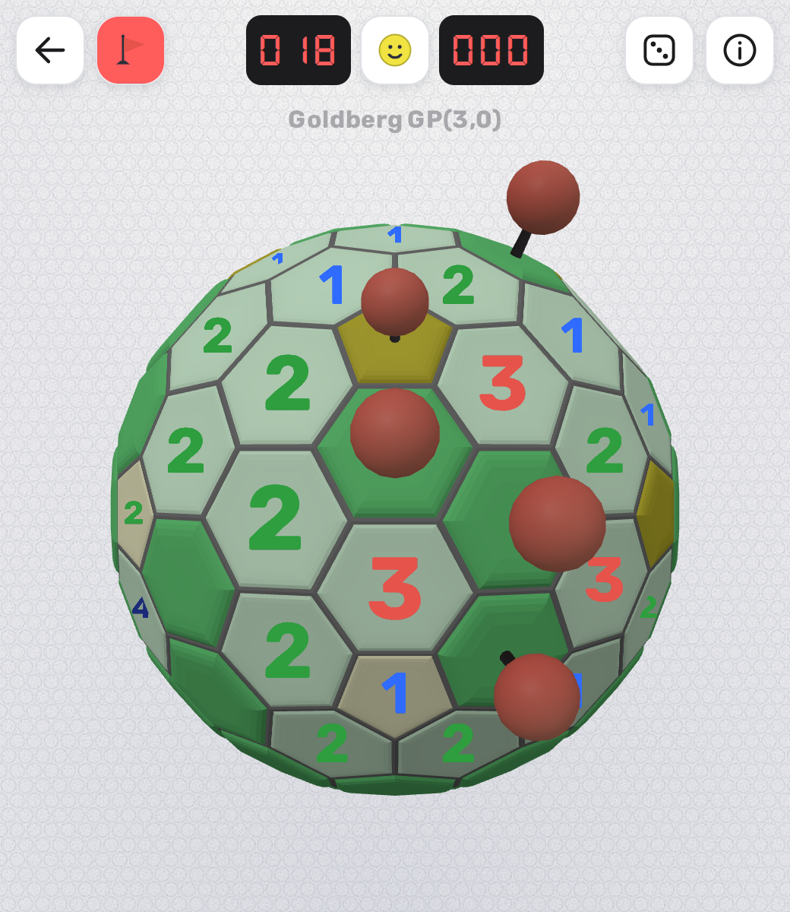
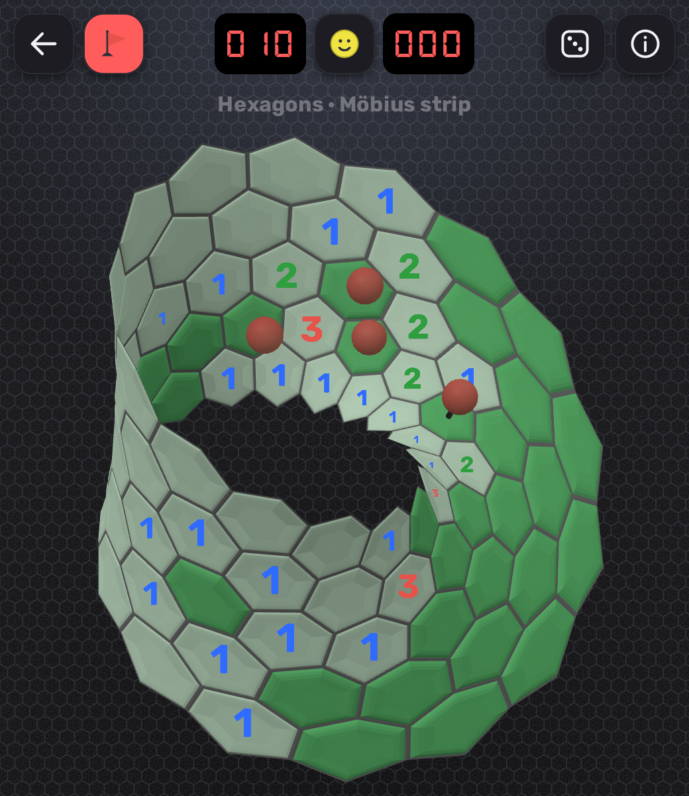
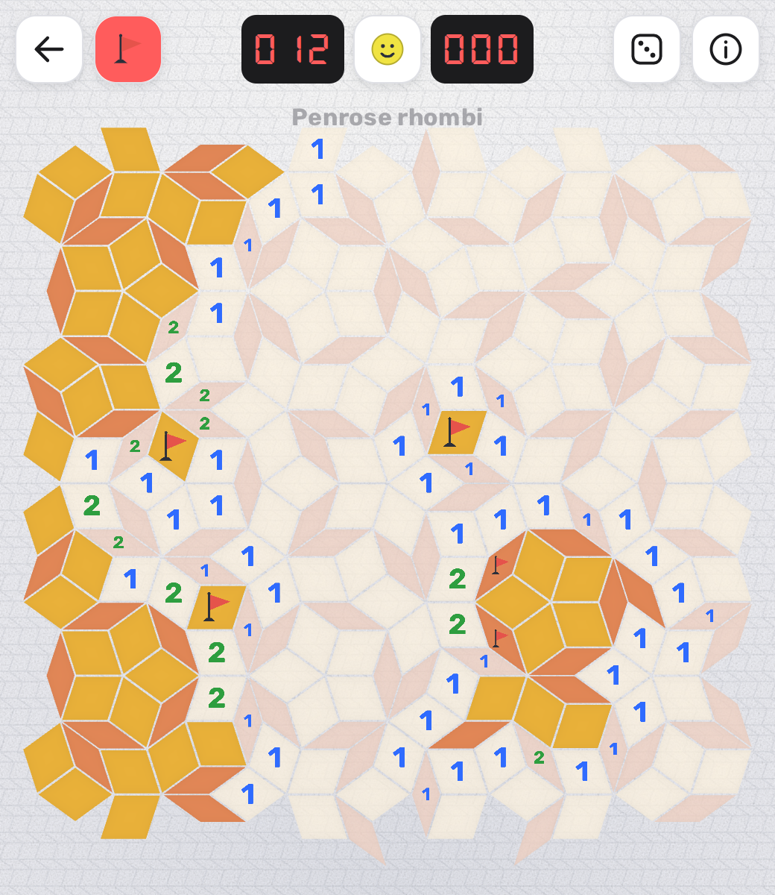
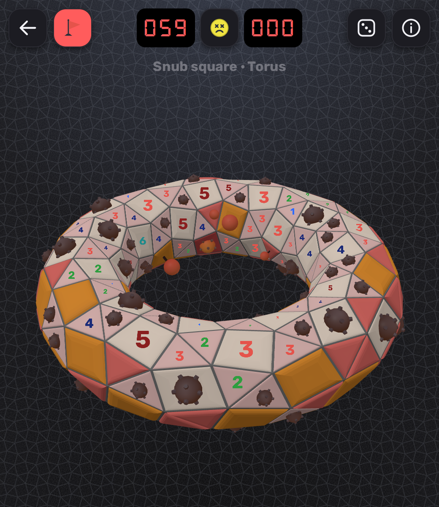
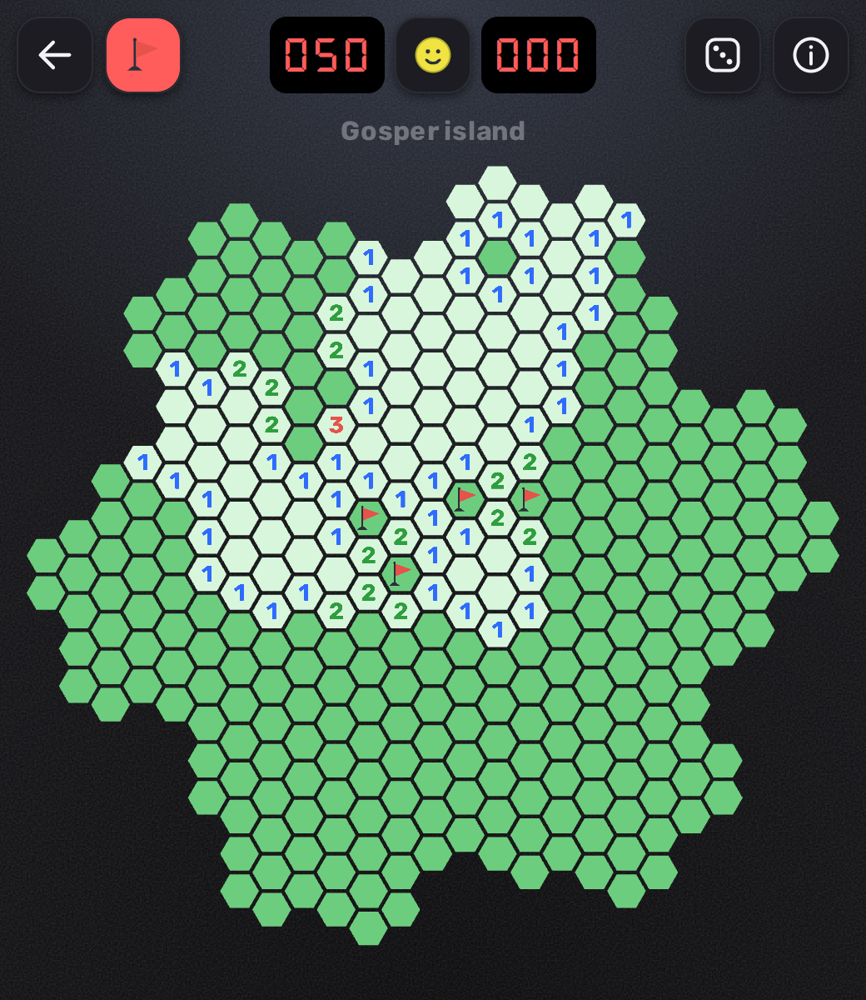
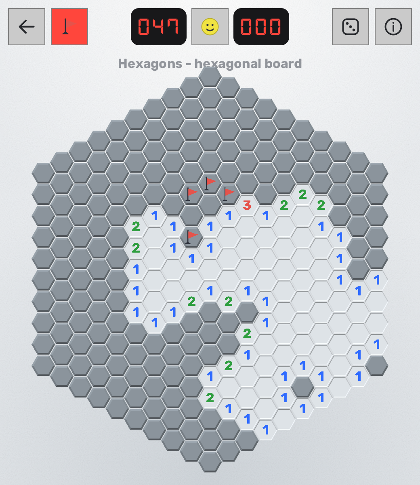
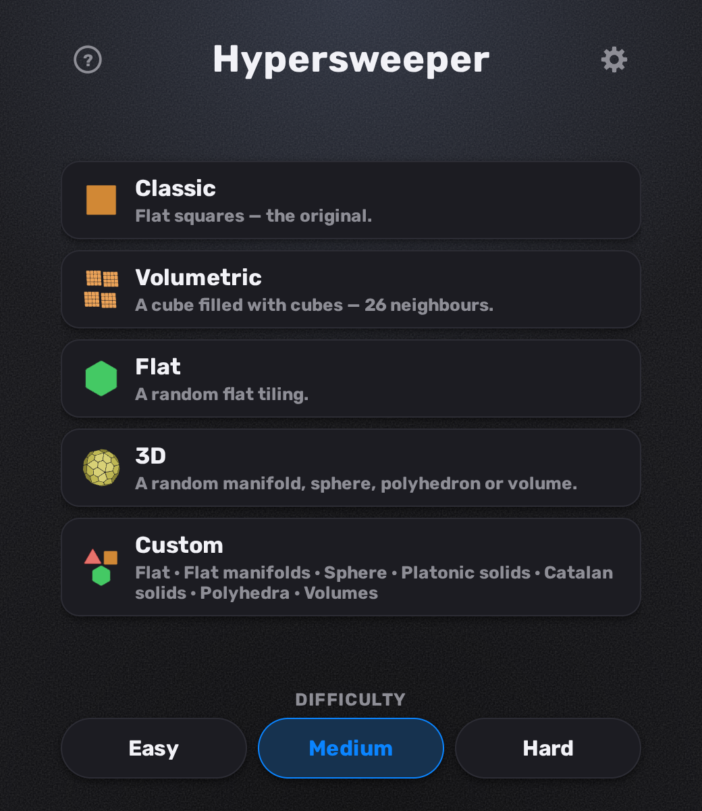
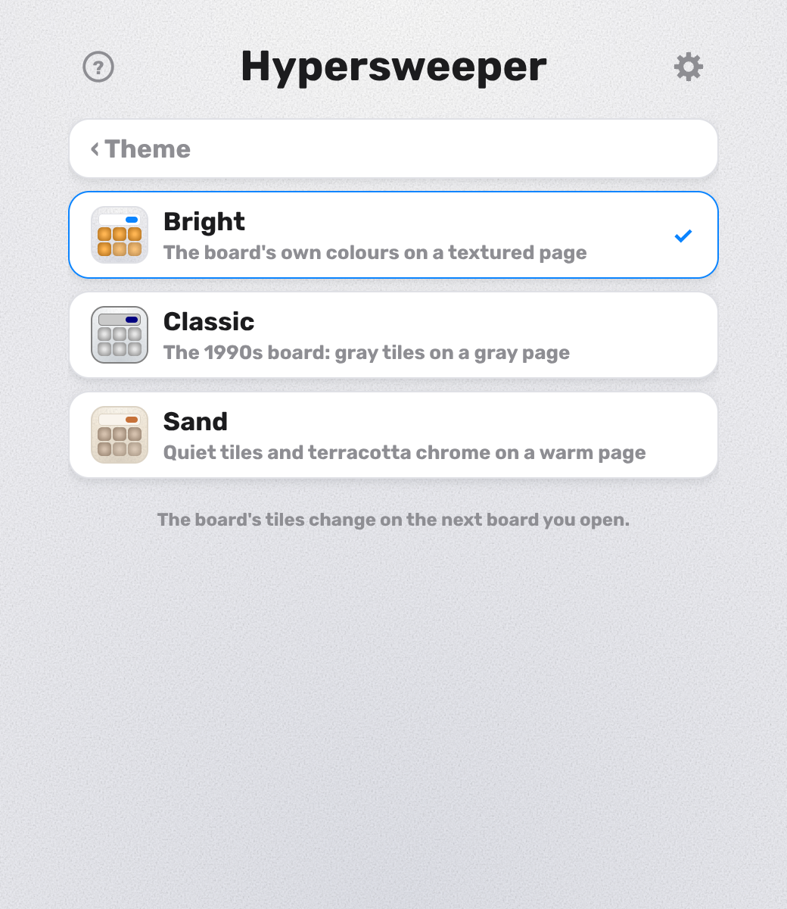
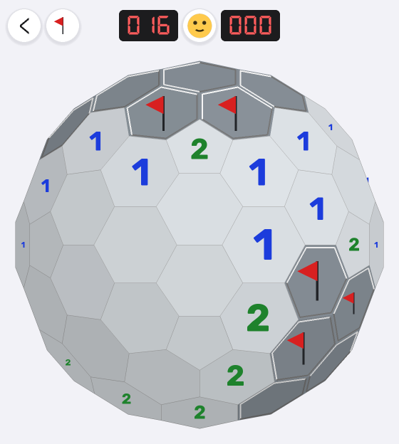

# Hypersweeper

Minesweeper on almost any surface and tiling: a flat aperiodic Penrose mosaic,
the hyperbolic plane, a Goldberg sphere, a Möbius strip, a trefoil knot.

**Play:** <https://hypersweeper.pages.dev/>. It runs in the browser, can be
installed, and works offline once loaded. It is also available as a Mac app and
an iPhone app.

<table>
  <tr>
    <td align="center"><br>Goldberg GP(3,0) on a sphere</td>
    <td align="center"><br>Hexagons on a Möbius strip</td>
  </tr>
  <tr>
    <td align="center"><br>Penrose rhombi</td>
    <td align="center"><br>Snub square on a donut, lost</td>
  </tr>
  <tr>
    <td align="center"><br>Hexagons in a Gosper island</td>
    <td align="center"><br>A hexagon of hexagons, classic theme</td>
  </tr>
  <tr>
    <td align="center"><br>The menu</td>
    <td align="center"><br>Themes, board shapes and colour schemes</td>
  </tr>
</table>

## Boards

Pick a surface, then a tiling. The rules are classic minesweeper: a number
counts the mines among a cell's neighbours, where two cells are neighbours
if they share a corner. That count changes from board to board: 6 on a
hexagon grid, 8 on squares, 15 on the hyperbolic {3,7} triangles, 26 inside
a cube of cubes.

- **Flat tilings**: the regular, uniform and Laves tilings; 2-uniform and
  2-isohedral tilings; convex pentagons; brick bonds; tilings that are not
  edge to edge.
- **Aperiodic and self-similar tilings**: Penrose's rhombi and kites and
  darts, Ammann–Beenker, the hat, the turtle and the spectre, spirals,
  rep-tiles and fractals such as the Sierpiński carpet and the Gosper island.
- **Hyperbolic tilings**: regular and uniform tilings drawn in the Poincaré
  disc, Böröczky's binary tiling, and closed hyperbolic surfaces such as
  Klein's quartic, which can be panned forever.
- **Spheres and solids**: Goldberg and geodesic spheres, and the Platonic,
  Archimedean and Catalan solids. Also polyhedral frames, stepped pyramids,
  and a cube filled with cubes that is played one slice at a time.
- **Surfaces**: the cylinder, the torus, the trefoil knot, the double torus,
  the Möbius strip, the Klein bottle, and the projective plane (as a sphere
  with antipodal cells glued, and as Boy's surface). Most flat periodic
  tilings can also wrap these.

Every board comes in Easy, Medium and Hard. Mine counts are not set by hand.
A solver plays each board thousands of times and adjusts the count until the
board is about as hard to win as the classic Windows board of that difficulty.

## Playing

- **Click or tap** to reveal a cell. The first reveal always opens an empty
  area. Click a revealed number to chord.
- **Right-click, long-press**, or the flag button in the header places or
  removes a flag.
- **Drag** a 3D board to turn it (the arrow keys work too). **Pinch** or
  <kbd>ctrl</kbd>+wheel zooms any board, and <kbd>0</kbd> frames it again.

Every board has a link (`?mode=…&difficulty=…`, plus `seed` for the exact
layout). Settings holds the best times, the achievements, three themes, three
colour schemes, three sound presets, and switches for animation and haptics.

**Privacy.** The website counts, anonymously, which boards get played and how
the games go. It uses no account, no cookie and no identifier, and records
nothing about the request (no IP address, country or user agent). It can be
turned off in Settings › Privacy. The Mac and iPhone apps are built without
the counter. The full policy is at
<https://hypersweeper.pages.dev/privacy>.

## Apps

- **Mac**: `make mac-app` (run on a Mac) packages the game, with everything
  it draws, into an app that never goes online. See
  [`shells/desktop/README.md`](../../shells/desktop/README.md).
- **iPhone**: `make ios-app` wraps the same game in Capacitor. This adds
  haptics through the Taptic Engine, Game Center, iCloud sync, an App Clip
  and an iMessage sticker pack. See [`ios/README.md`](ios/README.md).

## Development

```sh
npm install          # at the repo root (one npm workspace for every game)
cd apps/hypersweeper
npm run dev          # http://localhost:5173
npm run typecheck
npm run test         # unit tests (vitest)
npm run e2e          # end-to-end and visual tests (Playwright)
npm run build        # production bundle into dist/
npm run screenshots  # regenerate the gallery above
```

The game is TypeScript and Three.js. The board geometry is the shared
[`@tiling/geometry`](../../packages/geometry) package. [`AGENTS.md`](AGENTS.md)
is the guide to the code and links to the topic docs in [`docs/`](docs).

## The pygame reference implementation



The original game is a Python/pygame app in
[`minesweeper/`](../../minesweeper). It is no longer deployed, but it is still
the **reference implementation**. It generates the shared
[`data/*.json`](../../data) (the board catalogue, presets and menu screens)
and a conformance oracle that the TypeScript tests replay, so the two
versions always agree on the rules.

```sh
make venv            # .venv with every dependency (Python 3.13)
make run             # the game, from its menu
.venv/bin/python -m minesweeper --mode hexhex   # or start on one board
make test            # pytest
make lint            # ruff
```

See [`docs/agents/pygame.md`](../../docs/agents/pygame.md).
