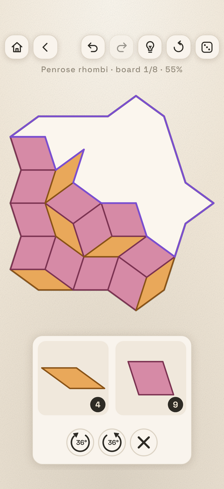
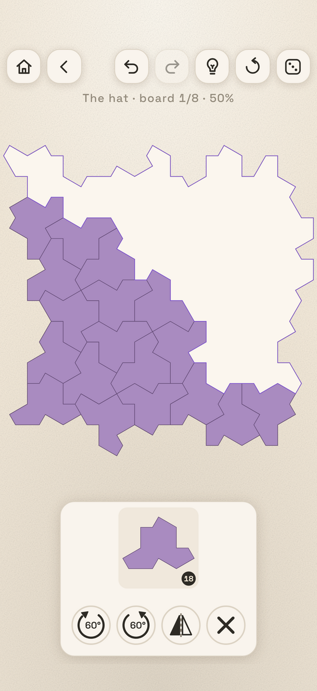
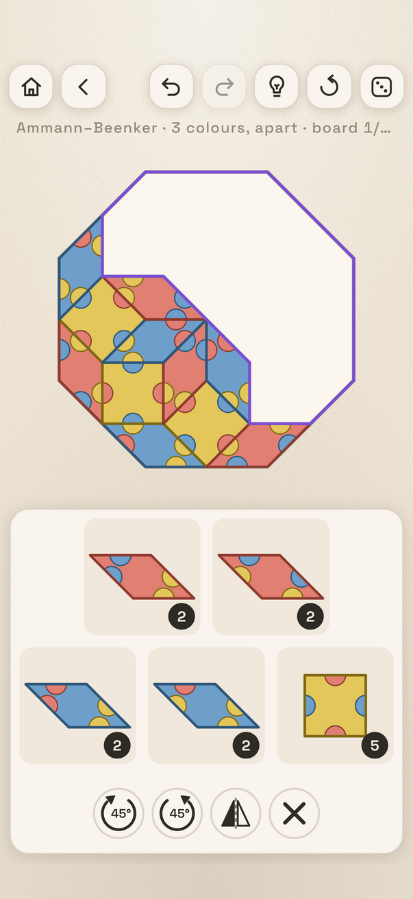
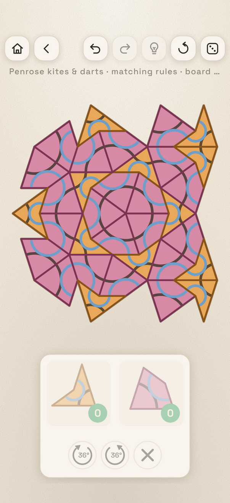
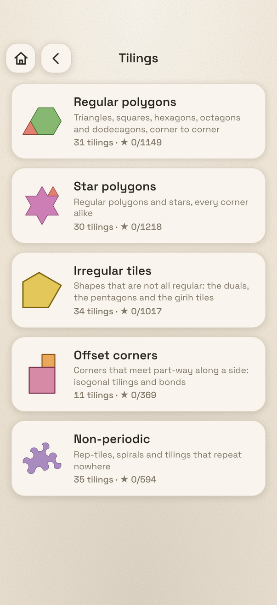
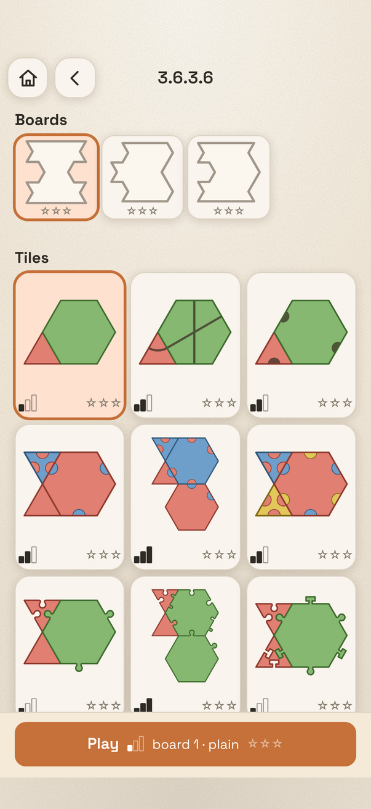

# Rep-tiles

A drag-and-drop tiling puzzle. You get an outlined region and a tray of tiles,
and you must cover the region exactly. Any exact cover wins, not only the one
the board was cut from, so six triangles where a hexagon was are fine. You
can also box yourself into a corner the board can't be finished from, and
then you have to take tiles back off.

**Play:** <https://tiling-games.pages.dev/rep-tiles/>. It runs in the browser
and works offline once loaded. It is also available as an iPhone and iPad app
and as a Mac app.

<table>
  <tr>
    <td align="center"><br>Penrose rhombi</td>
    <td align="center"><br>The hat</td>
    <td align="center"><br>Ammann–Beenker, coloured</td>
  </tr>
  <tr>
    <td align="center"><br>Kites and darts with Penrose's matching rules, finished</td>
    <td align="center"><br>The tilings, by group</td>
    <td align="center"><br>One tiling's boards and tile sets</td>
  </tr>
</table>

## Playing

- **Drag** a tile from the tray onto the board. It snaps to a corner of the
  uncovered area, and a ✓ shows where it will land before you let go.
- **Rotate** (<kbd>R</kbd>, or <kbd>Shift</kbd>+<kbd>R</kbd> to rotate the
  other way) turns every tile in the tray by the level's step. **Flip**
  (<kbd>F</kbd>) mirrors them, on levels that use a tile both ways round.
- **Take a tile off** by dragging it back to the tray, or switch on remove
  (<kbd>X</kbd>) and tap tiles.
- **Undo, redo and a hint.** The hint works out exactly what to do next: a
  tile to lay or, if the board can no longer be finished, a tile to remove.
- **Three stars** per level: one for finishing, one for not using a hint, and
  one for using exactly the tiles the board was cut from. Your best time is
  kept, and a half-finished board is saved and waits for you to come back.

## Levels

Thousands of levels are grouped by tiling: regular polygons, star polygons,
irregular tiles such as the Laves and pentagonal tilings, tilings with offset
corners such as brick bonds, and non-periodic tilings (rep-tiles, spirals and
aperiodic tilings like Penrose's, the hat and the spectre).

Each tiling is cut into several boards. Each board can be played with plain
tiles or with a marking that limits how tiles may meet:

- **Matching rules**: lines, or Penrose's arrows, must continue across every
  edge.
- **Colourings**: the tiles are coloured, for example as a checkerboard,
  and each edge shows which colour must lie across it.
- **Jigsaws**: a colouring drawn as knobs and sockets cut into the edges.

Difficulty is measured by a simulated player. It counts how much turning a
board needs, and how many tiles fit somewhere that turns out to be wrong.
Easy, Medium and Hard on the home screen each deal a random level from that
band.

## Development

```sh
npm install          # at the repo root (one npm workspace for every game)
cd apps/reptiles
npm run dev          # http://localhost:5174
npm run typecheck
npm run test         # unit tests (vitest, a few minutes)
npm run e2e          # Playwright smoke test
npm run build        # production bundle into dist/
```

The game is TypeScript with an SVG board. Coordinates are exact
(cyclotomic integers, not floats), so tiles meet with no rounding. The
tilings come from the shared [`@tiling/geometry`](../../packages/geometry)
package. [`AGENTS.md`](AGENTS.md) is the guide to the code, the level
pipeline and the deploy.

The iPhone and iPad app (`make ios-app GAME=reptiles`) adds haptics and
stores your stars in iCloud. See [`ios/README.md`](ios/README.md). The Mac
app is `make mac-app GAME=reptiles`; see
[`shells/desktop/README.md`](../../shells/desktop/README.md).
